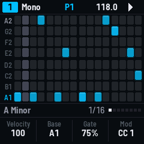

# SEQ-4 for the M-VAVE FM-1

[](https://github.com/devrvega/SEQ-4/actions/workflows/build.yml)
[](https://github.com/devrvega/SEQ-4/releases/latest)
[](LICENSE)

SEQ-4 turns the M-VAVE FM-1 into four MIDI sequencers for the instruments around it. Each sequencer plays on
its own channel and USB port (four ports, A–D: 64 channels) and runs in one of six modes: a melody, chords,
eight tracks of drums, or one of two generative modes. The screen is the grid, sixteen steps by eight rows of
lit pads; the white keys are the steps, the black keys the rows. Patterns, songs, LFOs, mod lanes, Euclidean
and drum generators, a harmonizer, recording and capture are all there. The FM-1 makes no sound of its own
apart from a metronome click: SEQ-4 is a controller.



| | |
|---|---|
| **[Try it in the browser](https://devrvega.github.io/SEQ-4/emu/)** | The same code the FM-1 runs, playing your synths through Web MIDI. No FM-1 needed. |
| **[Install it](https://devrvega.github.io/SEQ-4/install/)** | From Chrome or Edge, with the FM-1 on USB. Nothing to install on the computer. |
| **[Read the manual](docs/MANUAL.md)** | Getting started in ten steps, then every key, mode and menu. |
| **[Download](https://github.com/devrvega/SEQ-4/releases/latest)** | The firmware file (`seq4-X.Y.Z.fwsc`) of every release, and its source. |

## The six modes

| Mode | What a sequencer plays |
|---|---|
| **Mono** | A melody: a note a step on the rows of a scale (31 scales), with ties, legato, glide, octaves |
| **Poly** | Up to seven notes a step: play a hand on the keyboard, tap a step and it is there |
| **Chord** | A chord a step: its type (two banks, from triads to thirteenths), voicing, spread, strum, bass; its own arpeggiator |
| **Multitrack** | Eight tracks of triggers, each its own note, channel, port, length and division: drums. Euclid and a drum generator |
| **Stochastic** | Chances: how likely each of the twelve notes is, how far up or down, how long; it improvises |
| **Matriceal** | Four tracks of ten lanes (triggers, note, interval, pulses, velocity, octave, gate, chance, repeats, glide), each its own length and speed |

Each step has its velocity, gate (up to a tie or legato), octave, glide, timing offset, repeats (x1–x5, or
skipped) and a condition: a chance, A:B (play the A-th of every B times), first, fill, previous and their
opposites. A sequence is up to 128 steps in eight pages, any division from four bars to 1/64, forward, back,
pendulum, ping-pong, random or drunk, with a loop inside it.

## In short

| | |
|---|---|
| ALGORITHM · PRESETS | The sequencer (1–4) · its pattern (in at the next bar while it plays) |
| White keys | The page's 16 steps: tap on / off; hold one and press another: a tie |
| Black keys 1–8 · 9, 10 · 11 | The rows (Multitrack: its tracks) · the page back and on · MUTE |
| A step held + a black key · a black key held + steps | The step's note · drawn on that row |
| Knobs 1–4 | Velocity, octave, gate, mod (a step held: its own; GLO held: tempo, swing, scale, root) |
| PLAY · REC | Play / stop (held: a fill) · record (stopped: step by step; twice: capture) |
| SEQ · ENV · LFO · ARP · FX · SEL | The keyboard · mod lanes · LFOs · arpeggiator · random · division, length, loop |
| HOME · SAVE · EDIT · GLO | Back (held: the patterns) · save · undo (held: copy, paste) · shift (held: the setup) |

Hold any button for a second and a card says what it does.

## Installing, and going back

- **From the browser:** the [web installer](https://devrvega.github.io/SEQ-4/install/) (Chrome or Edge, a USB
  data cable).
- **From the command line:** download `seq4-X.Y.Z.fwsc` from the
  [latest release](https://github.com/devrvega/SEQ-4/releases/latest), then
  `pip3 install mido python-rtmidi` and `python3 tools/fm1_install.py seq4-X.Y.Z.fwsc`.
- **Going back:** the installer's "Back to the stock firmware" puts M-VAVE's firmware back, as does M-VAVE's
  own updater, M-UPGRADE. Any other FM-1 firmware installs over SEQ-4 as it would over the stock one.
- **Your saved work, and other firmwares':** SEQ-4 keeps its project, its 64 patterns and its songs in the
  FM-1's main store, where some firmwares keep their samples or songs. Its first save replaces what another
  firmware had saved there.

Installing other firmware is at your own risk, though it's hard to get stuck: an FM-1 that fails to start
twice comes up in a safe mode the installer can reach, and the manual's
[Troubleshooting](docs/MANUAL.md#21-troubleshooting) covers the rest.

## MIDI

The FM-1 has one USB port and a TRS MIDI input; SEQ-4's MIDI goes out over USB, on four ports (A–D) that a
computer sees as four MIDI devices, sixteen channels each. Its clock and start / stop go out on the ports you
choose. MIDI coming in (USB, or the TRS jack: a keyboard, a clock) records, transposes, plays the keyboard's
sequencer, follows the clock, loads patterns by program change, and drives MIDI mappings; the TRS jack's
messages can be passed on to a port. To play hardware synths, connect the FM-1 to a computer or a USB MIDI host.

## Status

SEQ-4 is young (0.x). It has been measured on an FM-1: the sequencers run every 0.73 ms. With all four as
busy as they get (eight tracks of drums with repeats and eight mod lanes, seven-note chords on every step,
strummed and arpeggiated chords, a 1/32 melody under two fast LFOs: about 1,800 MIDI messages a second at
200 BPM), a tick takes at most 545 µs of its 725 and none is late. At 120 BPM its sixteenths arrive at a
computer 125.0 ms apart, give or take 0.4 ms. The screen draws about 60 frames a second. Feedback on how it
plays is what helps most now.

## Ideas and problems

- **Something you'd like:** a [feature request](https://github.com/devrvega/SEQ-4/issues/new?template=feature_request.yml).
- **Something wrong:** a [bug report](https://github.com/devrvega/SEQ-4/issues/new?template=bug_report.yml)
  (the version is on the screen when the FM-1 starts).

## Make it your own

Fork it, change it, release your own: [CONTRIBUTING.md](CONTRIBUTING.md) says where things are, how to give
your version its own name and identity, and how to send changes back. Every push is built and tested on
GitHub; a tag `vX.Y.Z` makes a release, and the site (emulator, installer, manual) follows it.

```
tests/run_tests.sh                               # the tests, the app in a simulator
./build.sh                                       # build/gx1.fwsc (see BUILDING.md)
python3 tools/fm1_install.py build/gx1.fwsc      # install it over USB
```

## Credits

Many of SEQ-4's ideas come from the [OXI One](https://oxiinstruments.com/oxi-one/) sequencer by OXI
Instruments: its modes, conditions, generators, arranger and ways of working. SEQ-4 is its own, written for
the FM-1; no code, text or design of theirs is in it. The drum generator uses the drum map of
[Grids](https://github.com/pichenettes/eurorack/tree/master/grids) by Emilie Gillet (Mutable Instruments,
GPL-3.0-or-later). SEQ-4 is built on CRT-4, LCD-4 and IND-1, themselves built on
[AMB-1](https://github.com/charlesvestal/fm1-amb) by Charles Vestal: the frame, screen, simulator and emulator.
The platform (hardware layer, USB, update loader, storage, installer) is
[Felucca](https://github.com/hugelton/Felucca)'s by Leo Kuroshita (Hügelton Instruments), by way of
[X0X](https://github.com/charlesvestal/fm1-x0x), FoMni, AMB-1, IND-1, LCD-4 and CRT-4. The idea of running
FM-1 firmware in the browser comes from [Groove OS](https://www.groove-os.com/). GPL-3.0-only; see
[LICENSING.md](LICENSING.md).

M-VAVE and FM-1 are trademarks of their owners, as is OXI One. SEQ-4 is not affiliated with M-VAVE, OXI
Instruments, Mutable Instruments, Charles Vestal or Hügelton Instruments.
