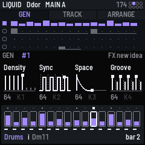
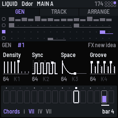
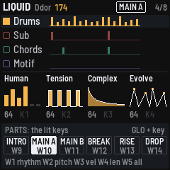

# GX-1 for the M-VAVE FM-1

[](https://github.com/jhallahan/seq-4-genre-ator/actions/workflows/build.yml)
[](https://github.com/jhallahan/seq-4-genre-ator/releases/latest)
[](LICENSE)

GX-1 turns the M-VAVE FM-1 into a genre-aware generative MIDI instrument. Pick a style (Liquid, Jungle, Dub techno,
Acid, Deep house, IDM and fourteen more), press a button, and it composes four tracks that fit together: **drums**,
a **sub** bass, **chords** and an **upper** part (lead, arpeggio or motif). Then you steer it. Mutate a track, lock
the ones you like, re-roll the rest, turn the macros, move between six song parts, change key. Everything plays out
over USB MIDI, and [SEQ-4](https://github.com/devrvega/SEQ-4)'s full sequencer is underneath for editing by hand.

  

| | |
|---|---|
| **[Read the manual](docs/GX1_MANUAL.md)** | Five minutes to your first track, then every control, style and part |
| **[Install it](https://jhallahan.github.io/seq-4-genre-ator/install/)** | From Chrome or Edge, with the FM-1 on USB. Nothing to install on the computer |
| **[Download](https://github.com/jhallahan/seq-4-genre-ator/releases/latest)** | The firmware file (`gx1-X.Y.Z.fwsc`) of every release, for the command-line installer |
| **[What's new](CHANGELOG.md)** | Each release's changes |

## Install the latest

- **From the browser:** the [web installer](https://jhallahan.github.io/seq-4-genre-ator/install/) in Chrome or
  Edge, with a USB data cable.
- **From the command line** (macOS, Linux, Windows): download `gx1-X.Y.Z.fwsc` from the
  [latest release](https://github.com/jhallahan/seq-4-genre-ator/releases/latest) and
  [`tools/fm1_install.py`](tools/fm1_install.py), then:

  ```
  pip3 install mido python-rtmidi
  python3 fm1_install.py --info                 # finds the FM-1
  python3 fm1_install.py gx1-X.Y.Z.fwsc         # installs (add --port FM-1 if other MIDI gear is plugged in)
  ```

- **A development build:** the newest green run under [Actions](https://github.com/jhallahan/seq-4-genre-ator/actions/workflows/build.yml)
  has a `gx1-firmware-…` artifact; install its `gx1.fwsc` the same way.
- **Going back:** the installer's "Back to the stock firmware", or M-VAVE's updater, M-UPGRADE. Any other FM-1
  firmware installs over GX-1 as it would over the stock one.

It works from M-VAVE's stock firmware and from other Felucca-based firmwares (SEQ-4, DUB-1, X0X…). Installing
other firmware is at your own risk, but it's hard to get stuck: an FM-1 that fails to start twice comes up in a safe
mode the installer can reach. See the manual's [recovery section](docs/GX1_MANUAL.md#12-going-back-and-recovery).

## Quick start

1. Connect the FM-1 to your computer. In your DAW take MIDI from **GX-1 A**: drums on channels **1** (kicks) and
   **2** (the kit), sub on **5**, chords on **7**, upper on **8**.
2. **PLAY**. **FX** for a new idea.
3. **ALGORITHM** for the family, **GLO + ALGORITHM** for the style.
4. Black keys **1–4** select a track: **SEL** mutates it, **ENV** locks it, **GLO + FX** re-rolls it.
5. **GLO + W9–W14**: the six song parts, at the next bar. **EDIT** undoes.

## Twenty-five styles in six families

| Family | Styles |
|---|---|
| **DNB** | Deep DnB · Liquid · Rollers · Jungle · Halftime · Autonomic |
| **BREAKS & BASS** | Breaks · UK garage · Electro · Dubstep |
| **TECHNO** | Minimal · Dub techno · Acid · Detroit · Hard |
| **HOUSE** | Deep house · Lo-fi house |
| **LEFTFIELD** | IDM · Downtempo · Ambient · Psybient · Glitch ambient |
| **POP & R&B** | Pop · R&B · Synth-pop |

The music engine is [fm1-genre-ator](https://github.com/jhallahan/fm1-genre-ator): integer-only C, deterministic
(the same style and idea number always give the same music), with the styles written as profiles.

## The controls in short

| | |
|---|---|
| FX · GLO + FX | A new idea · re-roll the selected track |
| SEL · GLO + W1–W5 | Mutate the selected track · its rhythm, pitch, velocity, length, or all |
| ENV · EDIT · GLO + EDIT | Lock · undo · redo |
| Black keys 1–4 · 5–8 | Select · mute drums, sub, chords, upper |
| GLO + W9–W14 | The song parts |
| K1–K4 · GLO + K1–K4 | Density, Sync, Space, Groove · Human, Tension, Complex, Evolve |
| ALGORITHM · PRESETS · SELECT | Family (GLO: style) · idea number · tempo |
| OCT− · OCT+ | The key down · up |
| SEQ · HOME | SEQ-4's grid · back to GEN |

GX-1 is a fork of SEQ-4, and everything in the [SEQ-4 manual](docs/MANUAL.md) is still there underneath.

## Ideas and problems

- **Something you'd like:** a [feature request](https://github.com/jhallahan/seq-4-genre-ator/issues/new?template=feature_request.yml).
- **Something wrong:** a [bug report](https://github.com/jhallahan/seq-4-genre-ator/issues/new?template=bug_report.yml)
  (the version is on the screen when the FM-1 starts).

## Make it your own

Fork it, change it, release your own: [CONTRIBUTING.md](CONTRIBUTING.md) says where things are, how to give
your version its own name and identity, and how to send changes back. Every push is built and tested on
GitHub; a tag `vX.Y.Z` makes a release, and the site (emulator, installer, manual) follows it.

```
tests/run_tests.sh                               # the tests, the app in a simulator
./build.sh                                       # build/gx1.fwsc (see BUILDING.md)
python3 tools/fm1_install.py build/gx1.fwsc      # install it over USB
```

## Credits

GX-1 is built on [SEQ-4](https://github.com/devrvega/SEQ-4) by devrvega; its credits follow.

Many of SEQ-4's ideas come from the [OXI One](https://oxiinstruments.com/oxi-one/) sequencer by OXI
Instruments: its modes, conditions, generators, arranger and ways of working. SEQ-4 is its own, written for
the FM-1; no code, text or design of theirs is in it. The drum generator uses the drum map of
[Grids](https://github.com/pichenettes/eurorack/tree/master/grids) by Emilie Gillet (Mutable Instruments,
GPL-3.0-or-later). SEQ-4 is built on CRT-4, LCD-4 and IND-1, themselves built on
[AMB-1](https://github.com/charlesvestal/fm1-amb) by Charles Vestal: the frame, screen, simulator and emulator.
The platform (hardware layer, USB, update loader, storage, installer) is
[Felucca](https://github.com/hugelton/Felucca)'s by Leo Kuroshita (Hügelton Instruments), by way of
[X0X](https://github.com/charlesvestal/fm1-x0x), FoMni, AMB-1, IND-1, LCD-4 and CRT-4. The idea of running
FM-1 firmware in the browser comes from [Groove OS](https://www.groove-os.com/). GPL-3.0-only; see
[LICENSING.md](LICENSING.md).

M-VAVE and FM-1 are trademarks of their owners, as are OXI One, Elektron and Tonverk. GX-1 and SEQ-4 are not affiliated with M-VAVE, OXI
Instruments, Mutable Instruments, Charles Vestal or Hügelton Instruments.
