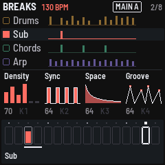

# GX-1: the GEN page

GX-1 starts on the GEN page. It shows the four generated tracks, the macros, and the selected track's steps.
SEQ-4's grid, keyboard, mod lanes and menus are all still there: HOME goes to the grid and back.

## The screen

| Area | What it shows |
|---|---|
| Top line | The genre, the key (`Em`, `F#m`), the tempo (in the selected track's colour; underlined when it is outside the genre's usual range), the part playing (boxed), and the bar (`1/8`) |
| Tracks | Drums (amber), sub (coral), chords (green), and the upper part (violet; its name follows the genre: Mid, Arp or Motif). Each row shows this bar's hits, and a hit's height is its velocity. The selected track is at full colour on a raised row. The others are dimmed but readable. A lock shows a locked track, and `M1`–`M4` its mutations. Muted tracks are grey and show `MUTE`. |
| K1–K4 | Density, Sync, Space and Groove, each drawn as a small picture with its value. Hold GLO for the second four: Human, Tension, Complex and Evolve. |
| Bottom strip | The selected track's 16 steps, one per white key. The dot above a step is the playhead, the fill is the velocity, and the bar under a step is the note's length. Its bottom line shows the chord playing (`VI Dmaj7`), or, with Chords selected, the whole progression (`i VII VI VII`) with the chord playing lit. Messages show there too. |

## The controls

| Control | On the GEN page |
|---|---|
| FX · GLO + FX | A new idea: the unlocked tracks get a new seed. While playing it comes in at the next bar line, from its bar 1 (mutations, macros and parts wait for the loop) · re-roll just the selected track |
| SEL | Mutate the selected track (every aspect) |
| ENV | Lock or unlock the selected track (ENV lights while it is locked) |
| EDIT · GLO + EDIT | Undo · redo (the engine's history) |
| HOME twice · HOME held | The patterns · the patterns while held (HOME alone stays on this page; on the grid, HOME comes back here) |
| SEQ | The grid, to edit by hand (HOME comes back). On the grid SEQ is the keyboard, as in SEQ-4 |
| GLO held | The second layer only (parts, mutate, the second four macros). SEQ-4's setup (GLO held long) opens from the grid page |
| Black keys 1–4 | Select drums, sub, chords, upper |
| Black keys 5–8 | Mute or unmute them |
| Black keys 9, 10 · 11 | The bar back and on · mute the selected track |
| White keys | The selected track's steps, as on the grid: tap one on or off, hold one for its values |
| GLO + W1–W4 · W5 | Mutate the selected track's rhythm, pitch, velocity or length · all of them |
| GLO + W9–W14 | The six parts (intro / main / varied / break / build / drop; each genre names its own). While GLO is held the strip shows them as tiles with their keys. A part comes in at the next bar, from its start (outlined, "NEXT BAR", until then) |
| K1–K4 (GLO: the second four) | The macros. The new value applies when the knob rests (about a quarter of a second). |
| ALGORITHM | The genre: Deep DnB, Breaks, Autonomic, Dub techno, IDM, Electro, UK garage, Minimal, Downtempo, Jungle, Halftime, Deep house, Acid, Dubstep. A new idea in that genre (from a fresh seed) starts when the knob rests. |
| PRESETS | The seed. A new idea from that seed starts when the knob rests, and locked tracks stay. |
| SELECT | The tempo. Any tempo plays; outside the genre's range it is underlined (Deep DnB 168–176, Breaks 122–135, Autonomic 160–175). Only choosing a genre resets it |
| OCT− · OCT+ | The key, a semitone down or up. Everything pitched moves (locked tracks too); the drums stay. EDIT undoes it |
| PLAY, REC, SAVE, SEQ, ARP, LFO | As in SEQ-4 |

While GLO is held, the white-key lights show that second layer: W1–W5 for mutate, and the part playing among W9–W14.

## Known limits of this first build

- **Tapping a drum step:** this adds the sound on the row last picked on the grid (its degree is a drum lane), not
  a sound chosen on this page.
- **Edits are not part of the idea:** steps edited by hand are SEQ-4 edits. The next new idea, mutation, macro or
  part change renders over them.
- **Hardware:** the screen layout and colours were tested in the host simulator, not yet on an FM-1.
