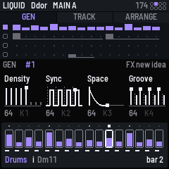
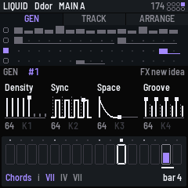
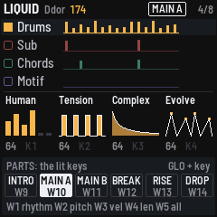
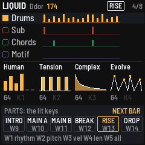
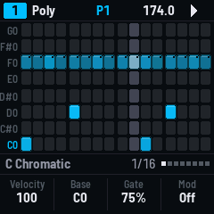

# GX-1 manual

GX-1 is firmware for the M-VAVE FM-1 that writes music for you, in a genre, and plays it out as MIDI. You choose a
style (Liquid, Dub techno, Acid, IDM…), press a button, and it composes four tracks that fit together: drums, a
sub bass, chords, and an upper part (a lead, an arpeggio or a motif). Then you steer it. Mutate a track, lock
the ones you like, re-roll the rest, turn the macros, move between song parts, change key. It is built on
[SEQ-4](MANUAL.md), so SEQ-4's grid, patterns and menus are all still underneath.

This manual covers version 0.2.

1. [Getting started in five minutes](#1-getting-started-in-five-minutes)
2. [Installing the latest version](#2-installing-the-latest-version)
3. [Connecting it up](#3-connecting-it-up)
4. [The GEN page](#4-the-gen-page)
5. [Families and styles](#5-families-and-styles)
6. [New ideas, mutate, lock, re-roll, undo](#6-new-ideas-mutate-lock-re-roll-undo)
7. [Song parts](#7-song-parts)
8. [The macros](#8-the-macros)
9. [Key, tempo and the progression](#9-key-tempo-and-the-progression)
10. [Every control on the GEN page](#10-every-control-on-the-gen-page)
11. [The grid underneath (SEQ-4)](#11-the-grid-underneath-seq-4)
12. [Going back, and recovery](#12-going-back-and-recovery)
13. [Troubleshooting](#13-troubleshooting)
14. [Experimental: USB host probe](#14-experimental-usb-host-probe)

## 1. Getting started in five minutes

1. **Install GX-1** ([section 2](#2-installing-the-latest-version)) and connect the FM-1 to your computer with a
   USB data cable. It shows **GX-1** while it starts, then the GEN page.
2. **Open your DAW** (Ableton Live, for example) and enable the FM-1's port **GX-1 A** as a MIDI input.
   Set up four instruments: drums on channels 1 and 2, a bass on channel 5, a pad or keys on channel 7,
   and a lead or pluck on channel 8. [Section 3](#3-connecting-it-up) has the details.
3. **Press PLAY.** The four tracks start.
4. **Press FX** for a new idea: all four tracks are rewritten from a new seed, starting at the next bar.
5. **Turn ALGORITHM** to change family (DNB, TECHNO, HOUSE…). **Hold GLO and turn ALGORITHM** to pick a style
   in that family.
6. **Press black keys 1–4** to choose drums, sub, chords or upper. Press **SEL** to mutate that track, or
   **ENV** to lock it so new ideas leave it alone.
7. **Hold GLO and press W9–W14** (the right-hand white keys) to move between the six song parts: intro, main,
   variation, break, build, drop. The part changes at the next bar.
8. **EDIT** undoes anything you didn't like.



## 2. Installing the latest version

> Installing doesn't erase the FM-1, and you can always go back to M-VAVE's firmware
> ([section 12](#12-going-back-and-recovery)). Keep the FM-1 on USB and don't unplug it until it restarts.

The FM-1 has a battery, so charge it first or keep it on USB power during the install.

### From the browser (easiest)

1. Open the **[web installer](https://jhallahan.github.io/seq-4-genre-ator/install/)** in **Chrome or Edge**
   (Safari and Firefox don't have Web MIDI with SysEx).
2. Connect the FM-1 with a USB **data** cable (some charging cables carry no data) and switch it on.
3. Press **Connect**, allow MIDI access, then **Install**. It takes about a minute. The FM-1 restarts into GX-1.

It works from M-VAVE's stock firmware and from any other Felucca-based FM-1 firmware (SEQ-4, DUB-1, X0X, AMB-1…).

### From the command line (macOS, Linux, Windows)

1. Download `gx1-X.Y.Z.fwsc` from the
   **[latest release](https://github.com/jhallahan/seq-4-genre-ator/releases/latest)**, and
   [`tools/fm1_install.py`](https://github.com/jhallahan/seq-4-genre-ator/blob/main/tools/fm1_install.py)
   (on GitHub: **Download raw file**).
2. Install the two Python libraries, once:

   ```
   pip3 install mido python-rtmidi
   ```

   On a Mac, if `python-rtmidi` fails to build, run `xcode-select --install` and then
   `sudo xcodebuild -license accept`, then try again.
3. Check the FM-1 is found, then install:

   ```
   cd ~/Downloads
   python3 fm1_install.py --info
   python3 fm1_install.py gx1-X.Y.Z.fwsc
   ```

   `--info` should print something like `FM-1_1000200 [running] port: GX-1 A`. If another MIDI device is
   plugged in (an M-VAVE wireless dongle shows up as `MidiPortB_030`, for example), unplug it or name the
   port: `python3 fm1_install.py gx1-X.Y.Z.fwsc --port FM-1`.

### A development build (newer than the latest release)

Every change is built on GitHub. Open the repository's **Actions** tab, then **Build and test**, then the newest
green run on the branch. Download the **gx1-firmware-…** artifact, unzip it, and install `gx1.fwsc` with the
command line as above. Development builds report themselves as `FM-1_770`.

## 3. Connecting it up

GX-1 sends everything on USB port **GX-1 A**. The FM-1 makes no sound of its own. The channels suit an Elektron
Tonverk, and work with any DAW:

| Track | MIDI channel | Notes |
|---|---|---|
| **Drums**: kicks | 1 | 60 kick A, 61 kick B |
| **Drums**: the kit | 2 | 60 snare, 61 ghost, 62 clap, 63 closed hat, 64 open hat, 65 ride, 66–67 percussion |
| **Sub** | 5 | the bass line |
| **Chords** | 7 | the chords |
| **Upper** | 8 | the lead, arpeggio or motif (its name changes by style: Mid, Arp or Motif) |

### With Ableton Live

1. In **Settings > Link, Tempo & MIDI**, turn on **Track** (and **Remote** if you like) for the input **GX-1 A**.
2. Make five MIDI tracks. Set each one's **MIDI From** to *GX-1 A*, with channels 1, 2, 5, 7 and 8, and its
   **Monitor** to *In*.
3. On the channel 1 and 2 tracks, a Drum Rack with pads on C3 and up (note 60 is C3 in Live).
4. To pass it on to a Tonverk or other hardware: set each track's **MIDI To** to the hardware's port and
   channel. GX-1 runs on its own clock. Live can follow it, or send clock to the Tonverk itself.

### Straight into the Tonverk

The FM-1's single USB-C port is a USB *device*, like a keyboard, so it needs a computer or a USB MIDI host in
between. A USB host box (one that has USB-A sockets for MIDI devices) does this without a computer. The TRS jack on the FM-1
is MIDI **in** only. See [section 14](#14-experimental-usb-host-probe) for the experiment to change this.

## 4. The GEN page

GX-1 starts on the GEN page.

| Area | What it shows |
|---|---|
| Top line | The style, the key (`Fm`), the tempo, the part playing (boxed), and the bar (`3/8`). The tempo is underlined when it's outside the style's usual range |
| Tracks | **Drums** (amber), **Sub** (coral), **Chords** (green) and **Upper** (violet). Each row shows this bar's hits; taller hits are louder. The selected track is bright on a raised row. A padlock marks a locked track; `M1`–`M4` its mutations. Muted tracks are grey and say `MUTE` |
| Knobs | The four macros, each drawn as a small picture with its value. Hold GLO for the second four |
| Bottom strip | The selected track's 16 steps, one above each white key. A dot shows the playhead, the fill the velocity, the bar underneath the note length. Below it: the chord playing (`VI Dbmaj7`) or, with Chords selected, the whole progression |



## 5. Families and styles

**ALGORITHM** chooses the family. **GLO + ALGORITHM** chooses the style in it. The screen shows both names, and a
new idea in that style starts when the knob stops (at its usual tempo, from a fresh seed). Each family remembers
the style you last used.

| Family | Styles (usual tempo, BPM) |
|---|---|
| **DNB** | Deep DnB (168–176) · Liquid (170–176) · Rollers (170–176) · Jungle (158–172) · Halftime (160–175) · Autonomic (160–175) |
| **BREAKS & BASS** | Breaks (122–135) · UK garage (128–136) · Electro (125–138) · Dubstep (136–144) |
| **TECHNO** | Minimal (120–128) · Dub techno (116–128) · Acid (124–135) · Detroit (126–136) · Hard (135–150) |
| **HOUSE** | Deep house (118–126) · Lo-fi house (115–124) |
| **LEFTFIELD** | IDM (110–150) · Downtempo (80–100) · Ambient (60–100) |

Each style has its own drum language, scale (minor, Dorian or Phrygian), chord progressions, bass behaviour and
upper part, and its own six song parts. The same style and seed always give the same music.

## 6. New ideas, mutate, lock, re-roll, undo

| Do this | Press | What happens |
|---|---|---|
| A new idea | **FX** | Every unlocked track is rewritten from a new seed. While playing, it starts at the next bar from bar 1 |
| Re-roll one track | **GLO + FX** | Only the selected track gets a new seed |
| Mutate | **SEL** | The selected track changes a little in every aspect. It keeps its character |
| Mutate one aspect | **GLO + W1–W4** | Rhythm, pitch, velocity or length of the selected track (W5: all four) |
| Lock | **ENV** | The selected track is kept through new ideas (ENV lights while it's locked) |
| Undo · redo | **EDIT · GLO + EDIT** | Back and forward through everything above, and key changes |
| A particular seed | **PRESETS** | Turn to choose the seed number; a new idea from it starts when the knob stops. Locked tracks stay |

A good way to work: press FX until the drums are right, lock them (ENV), then keep pressing FX for the other
three. Use SEL for small changes.

## 7. Song parts

Each style has six parts: an **intro**, a **main** part, a **variation**, a **break**, a **build** and a
**drop**. Each style names its own. Hold **GLO** and the bottom strip turns into six tiles, one above each of
the keys **W9–W14**; the part playing is lit. Press a key to queue that part. It's outlined and says
**NEXT BAR** until it starts, from its first bar, at the next bar line.




While GLO is held the white keys light up to match: W1–W5 for mutate, W9–W14 for the parts, with the part
playing blinking.

## 8. The macros

| Knob | Macro | What it does |
|---|---|---|
| K1 | **Density** | How many hits and notes (all tracks) |
| K2 | **Sync** | Syncopation in the drums: on the beat, or pushed off it |
| K3 | **Space** | Gaps and drop-outs: higher leaves more room (all tracks) |
| K4 | **Groove** | Swing in the drums |
| GLO + K1 | **Human** | Looser drum timing and velocity |
| GLO + K2 | **Tension** | Harmonic colour: plain triads at 0, sevenths, add9s and elevenths as it rises; the bass leaves the root more and the lead takes more colour tones |
| GLO + K3 | **Complex** | Detail: more off-beat 16ths, ghost notes and ratchets in the fills as it rises, octave leaps in the lead; simpler and squarer below 64 |
| GLO + K4 | **Evolve** | How much the loop changes over its bars (all tracks) |

A new value applies when the knob stops turning (about a quarter of a second), at the next loop. At 64 a macro
leaves the style as written.

**The parts lean on Tension and Complex for you.** Your knob sets the level for the whole idea, and each part adds
its own lean: the break opens the harmony, the build leans in hard and gets busier, the drop resolves to plainer
chords with a bit more detail, and the intro is plainer and simpler. Each picture shows what its macro does, in grey
where things start and in the track's colour where the knob has taken them, with a small square on the value: the
voices playing for Density, pulses sliding off the beat for Sync, the silence after a hit for Space, the swung
second hit for Groove, a line wandering for Human, a chord stacking up for Tension, the beat dividing for Complex,
and the loop drifting from its original for Evolve.

## 9. Key, tempo and the progression

- **Key:** OCT− and OCT+ move the key a semitone down or up. Everything pitched moves (locked tracks too); the
  drums stay. EDIT undoes it.
- **Tempo:** turn **SELECT**. Any tempo plays; outside the style's usual range it's underlined. Choosing a new
  style resets it, but new ideas, seeds and parts don't.
- **Progression:** select Chords (black key 3). The bottom line shows the progression in Roman numerals
  (`i VII VI VII`), with the chord playing lit.

## 10. Every control on the GEN page

| Control | On the GEN page |
|---|---|
| PLAY | Play / stop |
| FX · GLO + FX | A new idea · re-roll the selected track |
| SEL | Mutate the selected track |
| ENV | Lock / unlock the selected track |
| EDIT · GLO + EDIT | Undo · redo |
| SEQ | The grid (SEQ-4), to edit by hand. HOME comes back |
| HOME twice · HOME held | The patterns (HOME once stays on GEN) |
| GLO held | The second layer: parts, mutate, the second four macros |
| Black keys 1–4 | Select drums, sub, chords, upper |
| Black keys 5–8 | Mute / unmute drums, sub, chords, upper |
| Black keys 9, 10 · 11 | The bar back and on · mute the selected track |
| White keys | The selected track's steps: tap one on or off; hold one for its values |
| GLO + W1–W4 · W5 | Mutate rhythm, pitch, velocity, length · all four |
| GLO + W9–W14 | The six song parts (at the next bar) |
| K1–K4 · GLO + K1–K4 | The macros |
| ALGORITHM · GLO + ALGORITHM | The family · the style in it |
| PRESETS | The seed |
| SELECT | The tempo |
| OCT− · OCT+ | The key down · up |
| REC, SAVE, ARP, LFO | As in SEQ-4 |

## 11. The grid underneath (SEQ-4)

GX-1 writes its music into SEQ-4's four sequencers, so **SEQ** opens SEQ-4's grid with every note GX-1 wrote, and
you can edit there by hand. On the grid, SEQ is the keyboard and HOME comes back to GEN. Everything in the
[SEQ-4 manual](MANUAL.md) works: patterns, step values, LFOs, mod lanes, the setup (hold GLO on the grid).



Hand edits are SEQ-4 edits, not part of the idea: the next new idea, mutation, macro or part change writes over
them.

## 12. Going back, and recovery

- **Back to M-VAVE's firmware:** the web installer's **Back to the stock firmware** button, or M-VAVE's own
  updater, M-UPGRADE, from [m-vave.com/download](https://www.m-vave.com/download).
- **Another firmware:** any FM-1 firmware installs over GX-1 as it would over the stock one.
- **Saved work:** GX-1 keeps SEQ-4's project and patterns in the FM-1's flash, where other firmwares keep their
  samples or songs. Its first save replaces what another firmware saved there.
- **It won't start:** after two failed starts the FM-1 comes up in **GX-1 SAFE MODE**, which the installer can
  still reach: install again. Holding **OCT− and OCT+** for five seconds at power-on also enters the FM-1's
  update mode.
- **An install was cut off:** run the installer again. It finishes the write.

## 13. Troubleshooting

- **No sound:** that's expected from the FM-1 itself. Check that the DAW or synth listens to **GX-1 A** on
  channels 1, 2, 5, 7 and 8, and that the tracks are monitoring.
- **The installer finds the wrong device:** unplug other MIDI devices, or use `--port FM-1`.
- **`python-rtmidi` won't install on a Mac:** `xcode-select --install`, then `sudo xcodebuild -license accept`.
- **A part doesn't change:** hold GLO while pressing W9–W14, then wait for the next bar line (the tile says
  NEXT BAR). The lit keys show which ones do something.
- **Stuck notes:** stop. All notes are released.
- **The tempo is underlined:** it's outside the style's usual range. That's fine; it's only a hint.

## 14. Experimental: USB host probe

This build has a test for USB *host* mode, the first step towards plugging a USB MIDI device (for example, an
M-VAVE wireless dongle for a Tonverk) straight into the FM-1. It doesn't send music yet. It only checks whether
the FM-1's USB chip can see a device.

1. You need a **powered** USB-C OTG adapter: the FM-1 can't power the device on its own.
2. Switch the FM-1 off. Hold **SEQ** and switch it on: it shows **GX-1 USB HOST PROBE**.
3. Plug the device in through the adapter. The screen shows the line state, whether a device was seen, and its
   VID/PID if it answered.
4. Take a photo of the screen and share it in an issue. Switch the FM-1 off and on to go back to GX-1.

---

GX-1 is built on SEQ-4 by devrvega, itself built on Felucca by Leo Kuroshita (Hügelton Instruments), by way of
X0X, AMB-1 (Charles Vestal), IND-1, LCD-4 and CRT-4. GPL-3.0-only. M-VAVE, FM-1, Elektron and Tonverk are
trademarks of their owners; GX-1 isn't affiliated with any of them.
