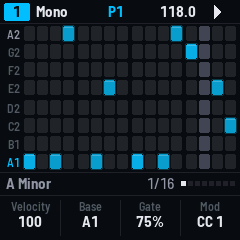
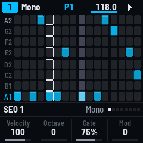
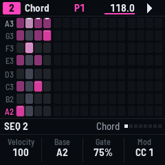
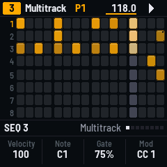
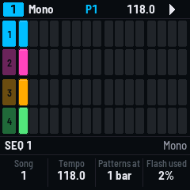
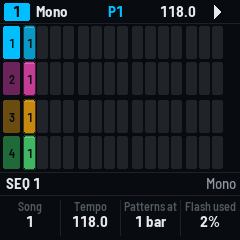
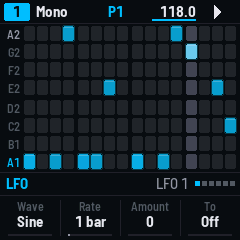
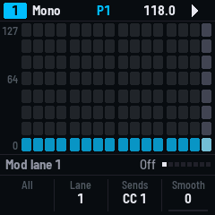
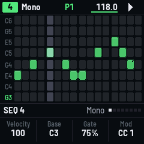

# SEQ-4 manual

SEQ-4 is firmware for the M-VAVE FM-1 that makes it four MIDI sequencers. This manual covers version 0.1.

1. [What it is](#1-what-it-is)
2. [Getting started in ten steps](#2-getting-started-in-ten-steps)
3. [The panel](#3-the-panel)
4. [The screen](#4-the-screen)
5. [Steps on the grid](#5-steps-on-the-grid)
6. [A step's values](#6-a-steps-values)
7. [The four sequencers](#7-the-four-sequencers)
8. [The six modes](#8-the-six-modes)
9. [The keyboard](#9-the-keyboard)
10. [Recording](#10-recording)
11. [Patterns](#11-patterns)
12. [Songs](#12-songs)
13. [Division, length, direction, loops](#13-division-length-direction-loops)
14. [Random and the generators](#14-random-and-the-generators)
15. [The arpeggiators](#15-the-arpeggiators)
16. [LFOs and mod lanes](#16-lfos-and-mod-lanes)
17. [MIDI mappings](#17-midi-mappings)
18. [Scales and the harmonizer](#18-scales-and-the-harmonizer)
19. [Playing live: mutes, fills, snapshots, timing](#19-playing-live-mutes-fills-snapshots-timing)
20. [MIDI, the setup, saving](#20-midi-the-setup-saving)
21. [Troubleshooting](#21-troubleshooting)
22. [Reference: the menus](#22-reference-the-menus)

## 1. What it is

The FM-1 makes no sound with SEQ-4 apart from a metronome click: everything it plays goes out as MIDI over
USB, on four ports (A, B, C, D), sixteen channels each. A computer, or a USB MIDI host box, passes it on to
synths, drum machines and software instruments.

There are four sequencers. Each has a MIDI channel and port, a mode, up to 128 steps and sixteen patterns.
They all run together, from SEQ-4's clock or from a MIDI clock coming in.

## 2. Getting started in ten steps

1. Install SEQ-4 (the web installer, or `tools/fm1_install.py`), connect the FM-1 to a computer, and open a
   synth there that listens to the FM-1's port A. The FM-1 starts with a demo: a bass on sequencer 1 (channel
   1), chords on 2 (channel 2), drums on 3 (channel 10), a lead on 4 (channel 4) that follows the chords.
2. Press **PLAY**. Press it again to stop.
3. The screen shows sequencer 1. Turn **ALGORITHM** to see the others; the status bar's number and colour say
   which.
4. Back on sequencer 1, tap a **white key** that is dark on the grid: a step lights there. Tap it again: off.
5. Hold a **black key** (they are the rows: the lowest row on the left) and tap a few white keys: the steps
   go on that row, a note of the scale.
6. Hold a step and turn **knob 1**: its velocity. Knob 2 its octave, knob 3 its length (gate).
7. Hold a step and press another to its right: a tie.
8. Press **SEQ**: the keys are a keyboard. Play. Press SEQ again for the grid.
9. Press **REC** while it plays, play the keyboard, press REC again: what you played is in the sequence.
   **EDIT** undoes it.
10. Press **SAVE**. Hold **HOME** for the patterns: press another key and that pattern comes in at the next
   bar.

Hold any button for a second and a card says what it does.

## 3. The panel

| Control | On its own | With another |
|---|---|---|
| **ALGORITHM** | The sequencer, 1–4 | GLO: the track (Multitrack, Matriceal) |
| **PRESETS** | Its pattern, 1–16 (in when the knob rests, at the next bar while playing) | |
| **SELECT** | A menu's pages; the grid's rows (Multitrack: the track; Matriceal: the lane) | |
| **Knobs 1–4** | Velocity, octave, gate, mod; a step held: its own; a menu: its values | GLO: tempo, swing, scale, root |
| **White keys** | The page's sixteen steps | See [Steps on the grid](#5-steps-on-the-grid) |
| **Black keys 1–8** | The rows (Multitrack: the eight tracks) | A step held: its note |
| **Black keys 9, 10** | The page back, on | GLO: the sequence rotated; SEL: halved, doubled; EDIT (10): duplicated |
| **Black key 11** | MUTE: the sequencer muted, or not | Held: white keys 1–4 mute the four sequencers, 5–12 the tracks |
| **PLAY** | Play, stop | Held while playing: a fill. GLO: tap tempo. REC held: record from the start. HOME held: to the top |
| **REC** | Record; stopped: step by step. Twice: capture | GLO: the recording settings. EDIT held: the track cleared |
| **HOME** | Back to the grid (and from there: the patterns) | Held: the patterns. GLO: the songs. With SAVE: a snapshot |
| **SAVE** | Save the pattern | Held: the patterns; a key saves into it |
| **SEQ** | The keyboard | GLO: the sequencer's settings (again: the track's or the lane's) |
| **ARP** | The arpeggiator's menu | GLO: hold. Held + a chord step: its chord on the knobs |
| **FX** | Random perform | GLO: the generators (again: the next); FX on one: it writes |
| **LFO** | The LFOs (again: the second) | GLO: MIDI mappings |
| **ENV** | The mod lanes | GLO: a lane's settings |
| **SEL** | Division and direction (twice: the loop) | Held + steps: the length, the range |
| **EDIT** | Undo | GLO: redo. Held + steps: copy, paste. Held + OCT: transpose |
| **GLO** | Shift | Held alone a moment: the setup |
| **OCT− / OCT+** | The rows down, up (GLO: an octave) | A step held: its octave. The keyboard: its octave |

**MASTER** is the click's volume. OCT− and OCT+ together for five seconds: the FM-1's update mode (as with
every FM-1 firmware).

## 4. The screen

- **The status bar:** the sequencer's number in its colour, its mode, its pattern (and, blinking, the one
  waiting to come in), the tempo (blue: following a clock coming in), and the transport: a triangle while
  playing, red when recording, a count-in's beats. A line under the number: a snapshot is held; under the
  mode: a song is playing.
- **The grid:** eight rows of sixteen pads. A lit pad is a step; brighter, louder. Ties join their pads. The
  playhead is the lighter column. Pads beyond the sequence's length are darker. A step with a chance or a
  condition has a corner cut; one with repeats two notches below; a muted step is an outline. A note above or
  below the rows shows at the top or bottom edge with a bar. The rows' notes are on the left (the root's
  brighter, the row picked last in the sequencer's colour).
- **The info line:** what just happened, a menu's name and page, or the scale and the division; the dots on
  the right are the eight pages (or the menu's).
- **The knobs:** what each of the four knobs does now, its value and where it is in its range.

## 5. Steps on the grid

| Do this | And |
|---|---|
| Tap a white key | A step on (on the row picked last), or off |
| Hold a black key, tap white keys | The steps drawn on that row (tapped again where they are: off) |
| Hold a white key, tap a black key | The step's note is that row's |
| Hold a white key, press another to its right | A tie: the first note held on to the second |
| ... to its left | The same note on each, not tied |
| Hold a white key, turn the knobs | Its values (see [A step's values](#6-a-steps-values)) |
| Hold a white key, tap MUTE | The step muted (kept, not played); again: back |
| Hold EDIT, press a step, then others | The first copied, pasted on the others |
| Black keys 9, 10 | The page back, on (eight pages: 128 steps) |
| GLO + black 9, 10 | The sequence rotated a step back, on |
| EDIT + black 10 | The steps again after themselves (the length doubled) |
| SEL + black 9, 10 | Condensed (half the steps at twice the speed) or expanded |
| Hold SEL, press a step | The sequence ends there; press two: it starts at the first and ends at the second |
| EDIT + OCT−, OCT+ | The sequence transposed a degree down, up |
| EDIT + REC | The sequence (Multitrack: the track) cleared |
| EDIT | Undo (twenty steps back); GLO + EDIT: redo |
| OCT−, OCT+, SELECT | The rows moved (GLO + OCT: by an octave) |

Knobs 1–4 with nothing held move every step at once: velocity, the base octave (Multitrack: the track's
note), gate, and the mod lane's values. As you turn, the knob shows the spread of the values; turned far, the
ends clip and the values even out.

## 6. A step's values

Hold one or more steps and turn the knobs:

| | Knob 1 | Knob 2 | Knob 3 | Knob 4 |
|---|---|---|---|---|
| **Held** | Velocity 1–127 | Octave −4…+4 (Multitrack: its note) | Gate: 1–100 %, Tie, Legato | The mod lane's value |
| **GLO + held** | Glide 0–100 | Condition | Repeats | Timing offset −45…+45 % |
| **ARP + a chord step** | Chord type | Voicing | Spread | Root |

- **Gate** is the note's length in the step. Past 100: **Tie** (held into the next step) and **Legato** (the
  next note starts before this one ends).
- **Glide** sends portamento time (CC 5) and portamento on (CC 65) if the sequencer's Glide CC is on.
- **Condition:** 0–100 % is a chance. Past 100: **A:B** (play the A-th time of every B: 1:2 the first of
  each two, 3:4 the third of four, up to 8:8), **Not A:B**, **Pre** (when the last condition played) and
  **Not pre**, **First** (the first time round) and **Not first**, **Fixed** (random perform leaves it alone),
  **Fill** (only while PLAY is held: a fill) and **Not fill**, **Locked** (fixed, and the generators leave it).
- **Repeats:** x1 to x5, the step's time divided among them; below x1, **Skip**: the step is passed over and
  the next takes its place.
- **Offset:** early or late by a share of the step.

## 7. The four sequencers

ALGORITHM picks the one on the screen. Each has, in its settings (GLO + SEQ, see the
[reference](#22-reference-the-menus)):

- its **channel** and **port** (A–D), a **program change** and **bank** sent when its pattern loads, and its
  **mode**;
- **Launch** (when its patterns change: as the setup says, at once, or every 1, 2, 4 or 8 bars), **Reset**
  (back to its first step every so many bars), and **Transpose** (MIDI notes on a channel transpose it);
- its **colour**, the **leader** its harmonizer follows (Poly: its most **voices** a step), **Glide CC**,
  and **Follow** (the grid's page follows the playhead);
- **Nudge** (± 100 ms) and **Time bend** (± 50 %: it drifts ahead or behind and comes back), new steps'
  **velocity** and **gate**;
- Chord mode: the chord **bank** (A or B), **auto voicing**, a **bass** note, and a **spread** for every step.

Knobs 1–4 with GLO: tempo (30–300 BPM), **swing** (50–75 %), **scale** and **root**.

## 8. The six modes

Change a sequencer's mode in its settings (GLO + SEQ, knob 4). A new mode starts empty, its settings kept.

### Mono

A note a step. The rows are a scale's degrees; OCT and SELECT move them. Steps take the row last picked
(black keys), so tapping steps after holding a row is quick.

### Poly

Up to seven notes a step (the Voices setting). A tap puts the hand you played last (the keyboard or MIDI, a
chord pressed together) on the step: play a chord on the keyboard, go back to the grid, tap steps. Black
key + steps adds or removes that row's note.

### Chord

A chord a step, built on the scale: its root is the row, its **type** from the bank (bank A: triad, seventh,
add9, sus2, sus4, sixth, ninth, eleventh, thirteenth, power, octave; bank B adds diminished, augmented,
dominant and others; the chromatic scale has its own lists), its **voicing** (close, open, open first, open
second, first and second inversions), **spread** (up to seven notes an octave up), **strum** (each note a
little later, up or down) and a **bass** note. A tap puts the chord last played on the chord keyboard. The
grid shows the root bright and the chord's other notes softer. Chords can play through the sequence's own
arpeggiator (ARP).

### Multitrack

Eight tracks of triggers, one row each (black keys 1–8 pick them). Each track has its note, channel, port,
length, division, direction, program, its own random perform and its own LFO switch (GLO + SEQ twice). The
demo has General MIDI drums on channel 10: kick, snare, closed and open hat, clap, toms, crash. A step's
knob 2 is its note against the track's. MUTE + black keys mute tracks; with GLO, solo.

The **drum generator** (GLO + FX, see [generators](#14-random-and-the-generators)) fills empty steps on tracks
1–3 (kick, snare, hats) from Grids' drum map, by X, Y, density and chaos. **Euclid** writes a track as
evenly spaced hits.

### Stochastic

It improvises from chances. The sixteen columns are its settings, the rows their values (hold a black key
and press a column):

| Columns | What |
|---|---|
| 1–12 | Each note's chance, C to B from the root (0 never, 7 most) |
| 13 | Octaves up (rows 5–8) and down (rows 1–4) |
| 14 | Longer (rows 5–8) and shorter (rows 1–4) notes |
| 15 | How often a new pitch |
| 16 | How often a new rhythm |

### Matriceal

Four tracks (GLO + ALGORITHM) of ten lanes, sixteen steps each: triggers, note, interval (added up, back to
the start at the lane's bounds), pulses (a trigger repeated), velocity, octave, gate, chance, repeats, glide.
Each lane has its own start, end, division and direction, so they drift against each other. OCT and SELECT
pick the lane shown; tapping a step turns a trigger on or off (on another lane, back to 0); black key + step
sets a lane's value by level; a step held, knob 1 its value and knob 2 its chance (on the pulses lane: all
pulses play, the first only, or tied). The lane's own settings are GLO + SEQ twice.

## 9. The keyboard

SEQ turns the keys into a keyboard for the sequencer on screen; SEQ again, back. It plays through the
sequencer's channel and port, and its arpeggiator if that is on.

- **Mono, Poly, Stochastic, Matriceal:** 27 keys from F; OCT− / OCT+ an octave (±3).
- **Chord:** the white keys are chords on the scale's degrees; the black keys change them: 1 and 2 the type,
  3 the voicing, 4 the spread, 5 the bass, 6 the bank, 7 and 8 the octave.
- **Multitrack:** drum pads: white keys 1–8 the tracks, 9–16 the same tracks accented; black keys 1–8 pick
  the track.
- **Knobs:** 1 the velocity, 2 pitch bend (it springs back), 3 the mod wheel (CC 1), 4 the **roller**: the
  keys held repeat at a division (1/4 to 1/32).

## 10. Recording

- **Live:** REC while playing (or REC + PLAY from the stop, after a count-in): the keys, or MIDI coming in,
  go where they fall, quantized as far as the recording settings say; held longer than a step, a tie. CCs
  coming in go into a mod lane that sends them. Overdub off: the steps the playhead passes are cleared.
  The modes are **loop**, **one shot** (it stops at the end) and **extend** (the sequence grows).
- **Step by step:** REC while stopped. Each note (or chord pressed together) goes on a step and the cursor
  (red) moves on; **SEL** ties the last note on, **EDIT** leaves a rest; SELECT or a white key moves the
  cursor. REC again, or PLAY, ends it.
- **Capture:** SEQ-4 keeps the last 256 notes played without recording. Press REC twice quickly: they go into
  the sequence, from the step the first fell in, and the sequence takes their length. EDIT undoes it.
- **Recording settings** (GLO + REC): quantize, its amount, overdub, mode; the count-in (a beat to two bars),
  the metronome (off, during the count-in, always), the click's level, and a MIDI click on a channel (port A,
  notes 37 and 36).

## 11. Patterns

Each sequencer has sixteen patterns. A pattern is everything about the sequencer: its steps, mode, settings,
LFOs, lanes and mappings.

- **PRESETS** picks the next one; it comes in when the knob rests, at the next boundary (the sequencer's
  Launch, or the setup's "Patterns at") while playing, at once when stopped. The status bar shows it waiting.
- **HOME** (from the grid) or **HOME held**: the patterns. Four rows of sixteen, a sequencer each: the loaded
  one bright, saved ones lit, the one playing pulses on the beat. A white key loads that pattern for the
  sequencer on screen; black keys 1–4 pick the sequencer.
- **SAVE** saves the sequencer into its pattern. **SAVE held** shows the patterns: a white key saves into it.
- On the patterns: **EDIT** held, a key copies that pattern, another pastes it there (into another
  sequencer's row, it keeps that sequencer's channel and port); **GLO** + a key empties it.
- A program change on the setup's "Program in" channel loads that pattern on all four.

Changes are kept even unsaved: SEQ-4 keeps each sequencer as it is a few seconds after the last change while
stopped, and comes back that way. SAVE is what puts it into the pattern.

## 12. Songs

GLO + HOME shows the arranger: ten songs, each four lanes (one per sequencer) of fifteen slots. A slot is a
pattern played so many times (or for ever), with a program change and bank if wanted, or a bar's silence.

- Black keys 1–4 pick the lane, white keys 1–15 the slot: a new slot takes the pattern loaded; the knobs set
  its pattern, repeats, program and bank. White key 16: the song's settings (a **master** lane the others
  follow, how long a repetition is, the song).
- GLO + a slot empties it; EDIT held: copy a slot, paste it. Black keys 9 and 10: the song before, after.
- **PLAY** on the arranger plays the song from its first slots; PLAY again stops it.

## 13. Division, length, direction, loops

SEL opens **Division**: the rows, the **direction** (forward, back, pendulum, ping-pong, random, drunk), a
**random division** (a chance that a step takes another length), and the **division** (4 bars to 1/64,
triplets included). Its second page: start, end, the loop on or off, the loop's own rate. Multitrack: the
track's.

SEL twice: **Loop**: from, to, rate and on. A loop plays part of the sequence over and over until it is off.

Hold SEL and press steps for the length (one step: it ends there; two: start and end).

## 14. Random and the generators

- **FX: random perform** varies the playing without changing the steps: velocity (+ up, − both ways),
  octave, trigger chance, repeats (+ more, − skips). Multitrack: each track's own. Steps marked Fixed or
  Locked are left alone.
- **GLO + FX: the generators.** On Multitrack, GLO + FX again goes Euclid → drum generator → random. On a
  generator's menu, **FX** writes:
  - **Random generator:** bias and range (degrees around the root; + above only), variety, density, and four
    special densities: **humanize** (velocity and timing nudged), **order** (the steps shuffled), **pitch**
    (the notes shuffled), **invert** (back to front). Its second page: a new scale too, humanize amount, ties.
    Multitrack: the track (GLO + FX: all eight).
  - **Euclid:** length, pulses, rotation, inverted; it writes the track as you turn.
  - **Drum generator:** density (the track's: kick, snare or hats), X, Y and chaos on Grids' map; FX turns it
    on or off for tracks 1–3.

## 15. The arpeggiators

ARP opens the arpeggiator. The **keyboard's** plays the keys you hold (on the keyboard, or MIDI coming in);
Poly and Chord sequences have their **own**, playing their steps' notes (on their grids ARP opens that
one). Mode (up, down, up-down, ends twice, inward, outward, in-out, pinky, thumb, random, random once, as
played), octaves (−3…+3), gate, division; accent (a groove), a Euclidean rhythm (length, pulses, notes a
pulse, rotation), and **hold** (GLO + ARP). Arp velocity, whether a new hand adds to the held notes, and
whether it starts again with each key are in the setup.

## 16. LFOs and mod lanes

Each sequencer has two **LFOs** (LFO; LFO again: the second): eleven waves, a rate synced (16 bars to 1/32)
or free (0.05 to 200 Hz), amount, phase, offset, retrigger with each note. Each goes to something inside
SEQ-4 (velocity, pitch, octave, gate, division, repeats, chance, glide, the arpeggiators, the other LFO, the
chords, Euclid, the drum generator, the stochastic chances, the intervals) and to MIDI: a CC, pitch bend,
pressure or program, by its own amount.

The **mod lanes** (ENV) are a value a step: four a sequencer (Multitrack: one a track), each sending a CC
(1, 74, 71 and 10 to begin), pitch bend, pressure or program, within a range, smoothed or not, and also
moving things inside like an LFO. On the lanes' view the rows are levels: hold a black key and press steps.
OCT and SELECT pick the lane; knob 3 its CC, knob 4 its smoothing. A lane can run on its own clock (its
division, start and end) or linked to its sequence's steps. GLO + ENV: a lane's settings.

## 17. MIDI mappings

GLO + LFO: sixteen mappings a sequencer, each a CC or a note coming in (its channel: the sequencer's, any, or
a given one), on the tracks you choose, that moves up to two things inside (as the LFOs' destinations, by an
amount and offset), changes up to two settings for good (tempo, scale, root, division, direction, loop,
mute, fill, generate, record, and more), and can be sent on as a CC. **Learn**: turn it on, move the control.

## 18. Scales and the harmonizer

31 scales and the harmonizer (GLO + knob 3): chromatic, major and minor, the modes, the pentatonics,
harmonic and melodic minor, blues and others. Changing it puts the steps onto the new scale. The setup's **Lock scale**
makes all four change together.

The **Harmonizer**, after the scales, follows another sequencer (its **leader**, in its settings): its rows are the
notes the leader's chords sound now. The demo's lead follows the chord sequencer. The setup's harmony page
says how far the follower may jump (an octave or more) and whether it keeps to its own octave.

## 19. Playing live: mutes, fills, snapshots, timing

- **MUTE** (black key 11): the sequencer on screen. Held, white keys 1–4 mute the four, 5–12 the tracks
  (with GLO: solo). The setup's **MUTE** says whether a muted sequencer keeps running silently or stops, and
  whether it happens at once or at its next boundary; **Keep mutes** keeps Multitrack mutes across patterns.
- **Fill:** hold PLAY while playing. Steps marked Fill play, Not fill don't.
- **Snapshot:** HOME + SAVE takes one (all four sequencers as they are); change anything; HOME + SAVE again
  and they come back at the next bar.
- **Tap tempo:** GLO + PLAY, a few times.
- **Nudge, time bend:** GLO + MUTE: each sequencer moved earlier or later by milliseconds, or bent (a gradual
  push or drag that comes back).

## 20. MIDI, the setup, saving

Hold GLO a moment for the **setup**: its pages are Clock, MIDI in, MIDI, Playing, Arp, Harmony, New steps,
Panel ([reference](#22-reference-the-menus)).

- **Clock:** its own, USB, TRS, or any (it follows a clock when one comes); clock and start / stop out on the
  ports chosen; whether start and stop coming in are obeyed; when patterns change.
- **MIDI in:** where the TRS jack's messages go (play the sequencer on screen, or passed on to port A–D);
  what USB notes do (only used, played, or echoed back); channel filtering (0: every note to the sequencer
  on screen; 1: to the sequencer on that channel; 2: Multitrack tracks by channel and note); notes put on the
  scale.
- **MIDI:** the program change channel that loads patterns; the transport as CCs (105 play, 106 stop, 107
  record, both ways); bank select as CC 32 instead of 0; whether muted tracks still send their lanes.

Saving uses the FM-1's flash. Writing to it while playing is quick; tidying it (erasing old saves) only
happens when stopped and idle, and pauses everything for a moment. The patterns view shows how full it is.

## 21. Troubleshooting

- **No sound:** SEQ-4 makes none; check that the receiving software or device listens to the FM-1's port
  and the sequencer's channel (GLO + SEQ). The FM-1 appears as one device with four ports; some computers show
  an old name for it until it is reconnected or forgotten in their MIDI settings.
- **It doesn't start / follows the wrong tempo:** the setup's Clock: "Own" ignores clocks coming in.
- **Stuck notes:** stop (all notes are released); HOME + PLAY stops and goes back to the top.
- **Everything gone strange:** EDIT undoes; loading the pattern again (PRESETS) brings back what was saved.
- **Starting fresh:** an erased store gives the demo. Reinstalling doesn't erase it; another firmware that uses
  the same flash does.
- **It won't start:** after two failed starts the FM-1 comes up in a safe mode the web installer can reach.
  OCT− and OCT+ held at power-on calibrates the panel; held for five seconds, the update mode.

## 22. Reference: the menus

A menu's four values are on knobs 1–4; SELECT turns its pages; HOME closes it.

### Sequencer (GLO + SEQ)

| Page | 1 | 2 | 3 | 4 |
|---|---|---|---|---|
| MIDI | Channel | Port | Program (off, 1–128) | Mode |
| Launch | Launch (global, now, 1–8 bars) | Reset bars | Bank | Transpose (off, its own channel, channel 1–16) |
| Sound | Colour | Leader (Poly: voices) | Glide CC | Follow |
| Time | Nudge (ms) | Time bend (%) | New velocity | New gate |
| Chords (Chord) | Bank A / B | Auto voicing | Bass | Spread for all |

### Track (Multitrack: GLO + SEQ twice)

| Page | 1 | 2 | 3 | 4 |
|---|---|---|---|---|
| 1 | Channel | Port | Note | Division |
| 2 | Program | Bank | Glide | LFOs (none, 1, 2, both) |
| 3 | Random perform on | Direction | Start | End |

### Lane (Matriceal: GLO + SEQ twice)

| Page | 1 | 2 | 3 | 4 |
|---|---|---|---|---|
| 1 | Start | End | Division | Direction |
| 2 | Random | Min (intervals) | Max | |
| 3 | The track's channel | Port | Note offset | Reset after (triggers) |

### Division (SEL), Loop (SEL twice)

| | 1 | 2 | 3 | 4 |
|---|---|---|---|---|
| Division 1 | Rows (Multitrack: track) | Direction | Random division | Division |
| Division 2 | Start | End | Loop | Loop rate |
| Loop | From | To | Rate | On |

### Random perform (FX), generators (GLO + FX)

| | 1 | 2 | 3 | 4 |
|---|---|---|---|---|
| Random perform | Velocity | Octave (Multitrack: gate) | Triggers | Repeats |
| Random generator 1 | Bias | Range | Variety | Density |
| Random generator 2 | Scale too | Humanize | Ties | |
| Euclid | Length | Pulses | Rotate | Invert |
| Drum generator | Density (the track's) | X | Y | Chaos |

### LFO (LFO; pages 4–6: the second)

| Page | 1 | 2 | 3 | 4 |
|---|---|---|---|---|
| 1 | Wave | Rate | Amount | To (inside) |
| 2 | Phase | Offset | Retrigger | MIDI (off, CC, bend, pressure, program) |
| 3 | CC | MIDI amount | | |

### Arpeggiator (ARP)

| Page | 1 | 2 | 3 | 4 |
|---|---|---|---|---|
| 1 | Mode | Octaves | Gate | Division |
| 2 | Accent | Length | Pulses | Repeats |
| 3 | Rotate | Hold | | |

### Mod lane (GLO + ENV)

| Page | 1 | 2 | 3 | 4 |
|---|---|---|---|---|
| 1 | Sends | CC | Min | Max |
| 2 | To (inside) | Amount | Offset | Smooth |
| 3 | To 2 | Amount 2 | Offset 2 | Linked to the steps |
| 4 | Division | Start | End | On |

### MIDI mapping (GLO + LFO)

| Page | 1 | 2 | 3 | 4 |
|---|---|---|---|---|
| 1 | Mapping (1–16) | Type (off, CC, note on, note off) | Channel (its own, 1–16, any) | Number |
| 2 | Learn | Tracks | Send as CC | Consume |
| 3, 4 | To (inside) | Amount | Offset | |
| 5, 6 | Setting | Amount | Offset | |

### Recording (GLO + REC)

| Page | 1 | 2 | 3 | 4 |
|---|---|---|---|---|
| 1 | Quantize | Amount | Overdub | Mode (loop, one shot, extend) |
| 2 | Count-in | Metronome | Click level | MIDI click (off, channel 1–16) |

### Nudge (GLO + MUTE)

Page 1: each sequencer's nudge (± 100 ms); page 2: each one's time bend (± 50 %).

### Song slot, song (the arranger)

| | 1 | 2 | 3 | 4 |
|---|---|---|---|---|
| Slot | Pattern (1–16, blank, empty) | Repeats (for ever, x1–x19) | Program (the pattern's, 1–128, off) | Bank |
| Song (white key 16) | Master lane | Launch (its end, 1–8 bars) | Patterns at | Song (1–10) |

### Setup (GLO held)

| Page | 1 | 2 | 3 | 4 |
|---|---|---|---|---|
| Clock | Clock (own, USB, TRS, any) | Clock out (ports) | Ignore start | Patterns at |
| MIDI in | TRS in | USB in | In channels | To the scale |
| MIDI | Program in | Transport CC | Bank LSB | Muted send |
| Playing | PLAY (stop, pause, restart) | MUTE (stop now, at its end, mute now, at its end) | Keep mutes | Tap count |
| Arp | Arp velocity | Hold adds | Arp restarts | |
| Harmony | Octave jump | Base octave | Lock scale | |
| New steps | Velocity | Gate | Mod smooth | |
| Panel | Lights (off, keys and buttons, keys) | Glow | | |
